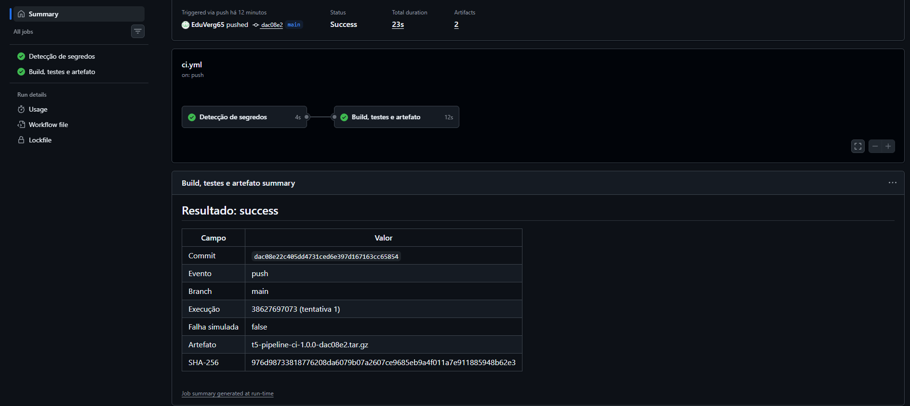

# Evidências de execução

> Preencha depois de rodar o pipeline no GitHub (passo a passo no fim deste arquivo).
> Salve as capturas de tela em `docs/evidencias/` e troque os `<...>`.

## Evidência 1 — Execução bem-sucedida

| Campo | Valor |
|---|---|
| Link da execução | `https://github.com/<usuario>/<repositorio>/actions/runs/<id>` |
| Gatilho | `push` na `main` |
| Commit | `<sha completo>` |
| Data | `<dd/mm/aaaa hh:mm>` |
| Resultado | ✅ Sucesso — 13 testes aprovados |
| Artefato | `t5-pipeline-ci-1.0.0-<commit7>.tar.gz` |
| SHA-256 | `<hash>` |

Capturas:
- `evidencias/01-sucesso-visao-geral.png` — os dois jobs em verde
- `evidencias/02-sucesso-testes.png` — log da etapa *Executar testes*
- `evidencias/03-sucesso-artefatos.png` — seção *Artifacts* com o `.tar.gz`
- `evidencias/04-sucesso-resumo.png` — *Summary* com commit e SHA-256

## Evidência 2 — Falha detectada

| Campo | Valor |
|---|---|
| Link da execução | `https://github.com/<usuario>/<repositorio>/actions/runs/<id>` |
| Gatilho | `workflow_dispatch` com `simular_falha = true` |
| Commit | `<sha completo>` |
| Resultado | ❌ Falha na etapa *Executar testes* |
| Mensagem | `Falha simulada solicitada (SIMULAR_FALHA=true) — o pipeline deve ser interrompido aqui` |
| Comportamento | *Build*, *Gerar artefato* e *Publicar artefato* foram **puladas**; nenhum artefato do código foi publicado. Relatório de testes e resumo foram publicados mesmo assim. |

Capturas:
- `evidencias/05-falha-visao-geral.png` — job em vermelho, etapas seguintes puladas
- `evidencias/06-falha-log.png` — log com o teste que falhou (esperado × obtido)

---

## Como gerar as evidências

**Sucesso:** basta enviar o código para a `main` (`git push`). Abra *Actions* → execução mais recente.

**Falha:** *Actions* → *CI* → **Run workflow** → marque **simular_falha** → **Run workflow**.

Alternativa mais "realista" para a falha: crie um branch, altere `src/pedido.js` (ex.: troque `limiteGratis = 200` por `300`), abra um Pull Request para a `main` e mostre o PR bloqueado pelo ✗ vermelho. Depois feche o PR sem fazer merge.
