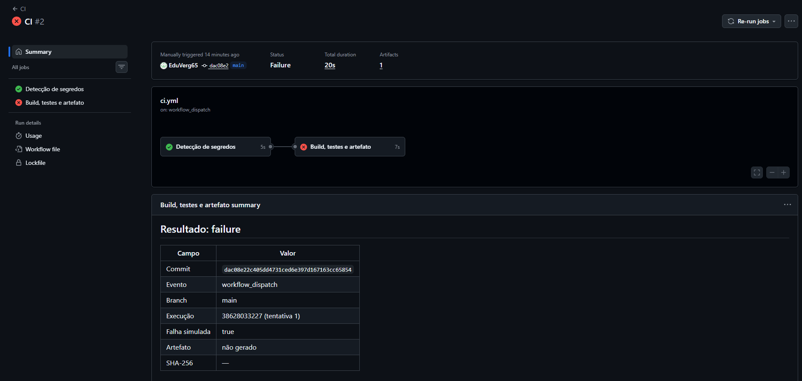
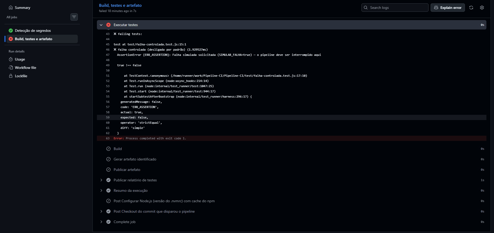

# Evidências de execução

Repositório: https://github.com/EduVerg65/Pipeline-CI
Ferramenta: GitHub Actions — workflow `CI` (`.github/workflows/ci.yml`)

## Evidência 1 — Execução bem-sucedida

| Campo | Valor |
|---|---|
| Link da execução | https://github.com/EduVerg65/Pipeline-CI/actions/runs/38627697073 |
| Execução | CI #1 (tentativa 1) |
| Gatilho | `push` na `main` |
| Commit | `dac08e22c405dd4731ced6e397d167163cc65854` |
| Data | 14/10/2026 |
| Duração | 23 s |
| Resultado | ✅ Sucesso — Detecção de segredos e Build, testes e artefato aprovados; 13 testes aprovados |
| Artefato | `t5-pipeline-ci-1.0.0-dac08e2.tar.gz` (+ `.sha256`) |
| SHA-256 | 976d98733818776208da6079b07a2607ce9685eb9a4f011a7e911885948b62e3 |

Capturas:
- `evidencias/01-sucesso-visao-geral.png` — os dois jobs em verde e a tabela de resumo
- `evidencias/02-sucesso-testes.png` — log da etapa *Executar testes* com os 13 testes aprovados
- `evidencias/03-sucesso-artefatos.png` — seção *Artifacts* com o `.tar.gz` e o relatório de testes

## Evidência 2 — Falha detectada

| Campo | Valor |
|---|---|
| Link da execução | https://github.com/EduVerg65/Pipeline-CI/actions/runs/38628033227 |
| Execução | CI #2 (tentativa 1) |
| Gatilho | `workflow_dispatch` (execução manual) com `simular_falha = true` |
| Commit | `dac08e22c405dd4731ced6e397d167163cc65854` (o mesmo da evidência 1) |
| Data | 14/10/2026 |
| Resultado | ❌ Falha na etapa *Executar testes* do job *Build, testes e artefato* |
| Mensagem | `Falha simulada solicitada (SIMULAR_FALHA=true) — o pipeline deve ser interrompido aqui` |
| Comportamento | *Build*, *Gerar artefato* e *Publicar artefato* foram **puladas**. Apenas 1 artefato foi publicado (o relatório de testes); o pacote `.tar.gz` **não** foi gerado. O resumo da execução também foi publicado, pois essas etapas rodam com `if: always()`. |

Como é o mesmo commit da evidência 1, a comparação mostra que a diferença de resultado vem só da falha introduzida — o pipeline detectou o problema e não deixou passar um artefato.

Capturas:
- `evidencias/04-falha-visao-geral.png` — job em vermelho, 1 artefato, resumo com "Artefato: não gerado"
- `evidencias/05-falha-testes.png` — log dos testes: 12 aprovados, 1 falhou (`fail 1`)
- `evidencias/06-falha-erro-etapas.png` — mensagem de erro (esperado × obtido), `exit code 1` e etapas Build/Artefato puladas

---

## Como reproduzir

**Sucesso:** enviar um commit para a `main` (`git push`) e abrir *Actions* → execução mais recente.

**Falha:** *Actions* → *CI* → **Run workflow** → marcar **simular_falha** → **Run workflow**.

Alternativa: criar um branch, alterar `src/pedido.js` (ex.: trocar `limiteGratis = 200` por `300`), abrir um Pull Request para a `main` e observar o PR marcado com ✗ pelo pipeline. Depois fechar o PR sem fazer merge.